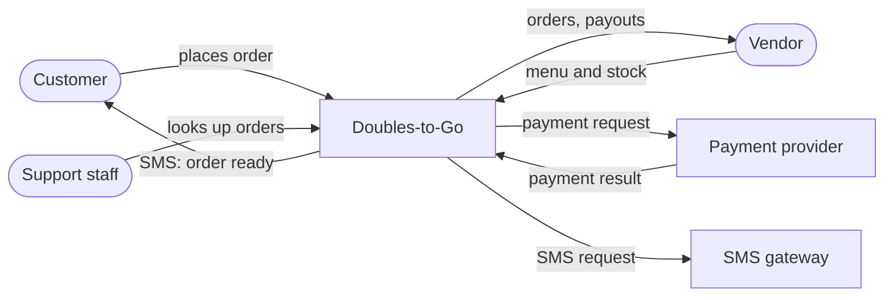
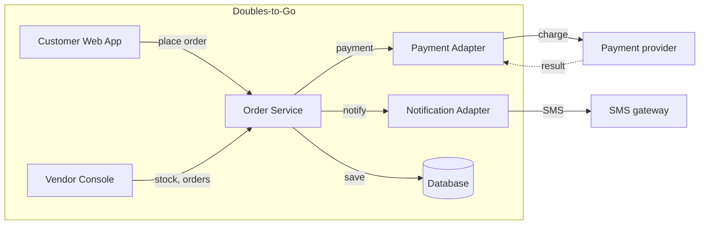
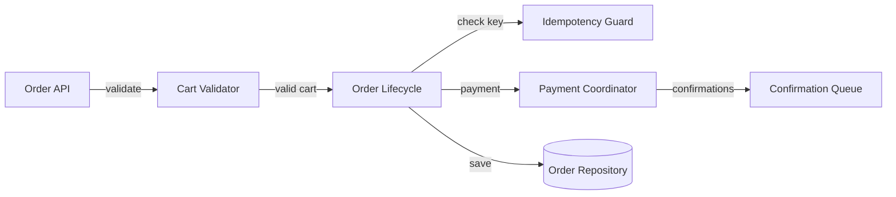
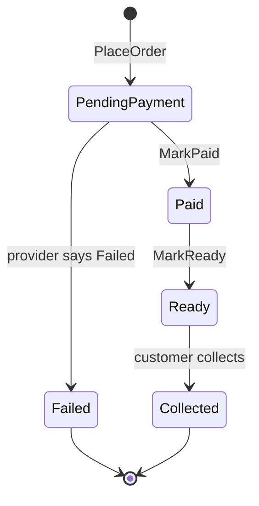
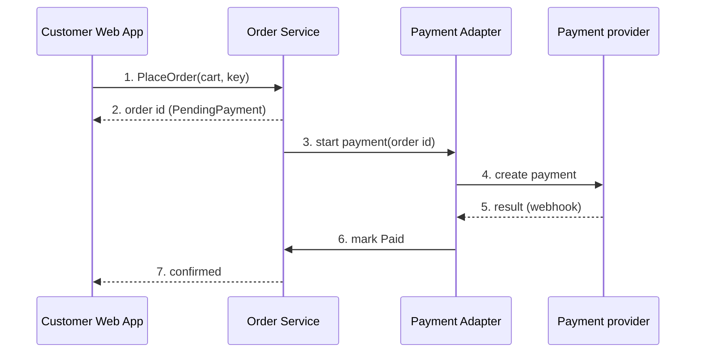
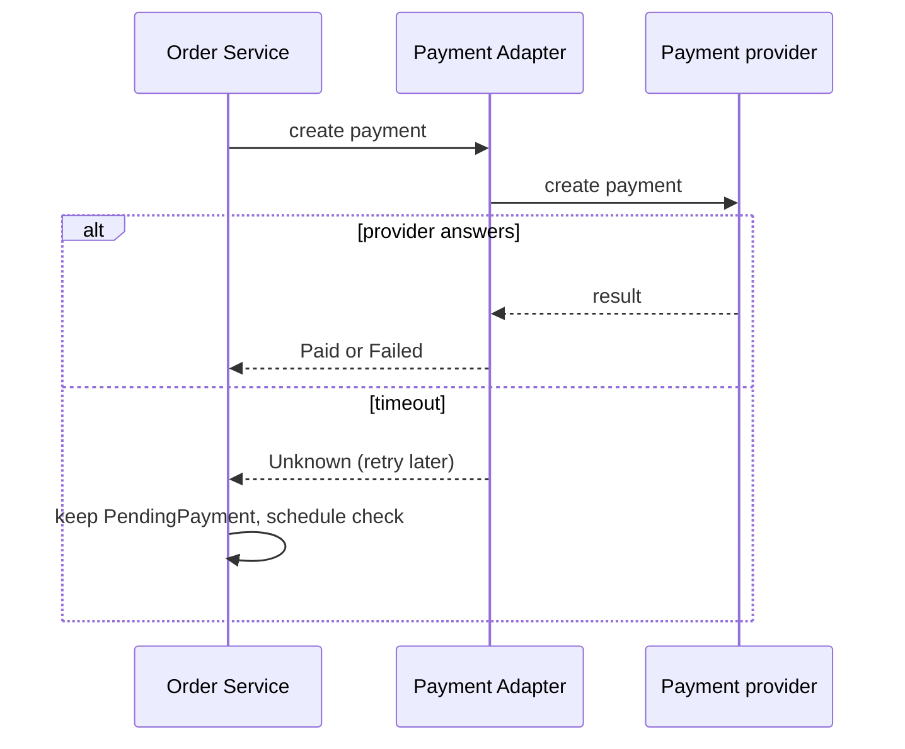
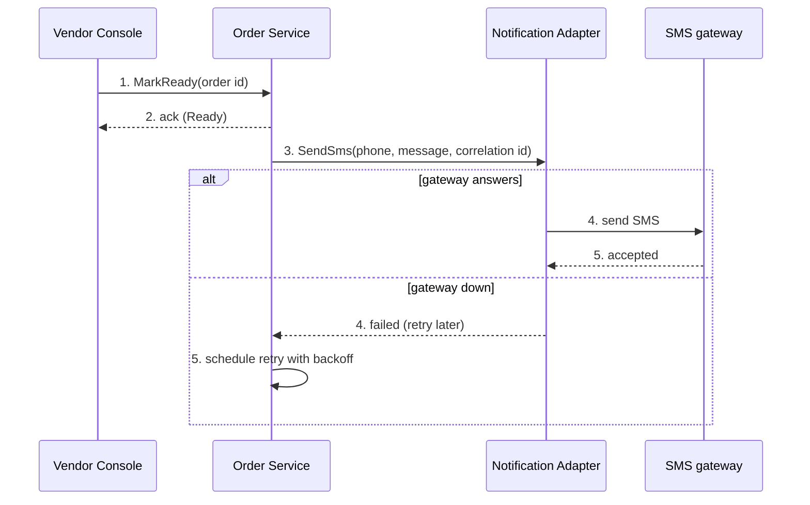
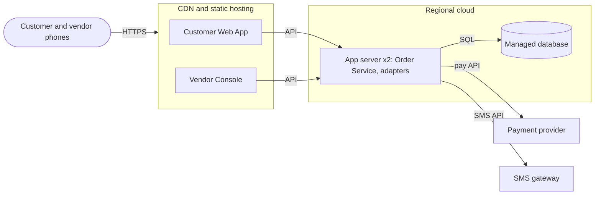
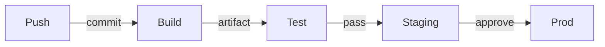
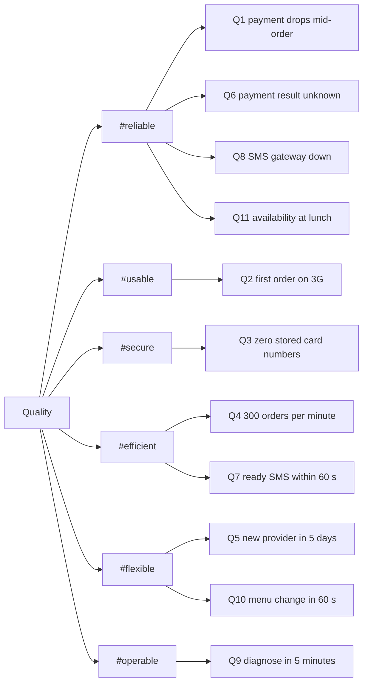

# Doubles-to-Go: architecture documentation (arc42)

| | |
|---|---|
| **Status** | Worked example for the arc42 workshop. Version 0.2, reconciled with the working app in `app/` |
| **Date** | 2026-11-03 |
| **System** | Doubles-to-Go, a pre-order web app for street-food vendors in Trinidad |
| **Template** | arc42, a free and open template for architecture documentation by Gernot Starke and Peter Hruschka |

**How to read this document.** Sections 1 to 4 say why the system exists and which approach was chosen. Sections 5 to 8 describe structure and behaviour. Sections 9 to 12 record decisions, quality, risks and vocabulary. Every constraint, scenario, decision and risk has a stable ID (C1, Q1, ADR-0001, R1) so other sections and tools can refer to it. The ID index at the end lists them all.

---

## 1. Introduction and Goals

### 1.1 Requirements overview

Doubles-to-Go lets customers order from nearby street vendors on their phone, pay online and collect without queuing. It replaces phone calls, WhatsApp messages and cash-only queues, which lose orders at peak lunchtime.

**Key functions**

1. Browse vendors and their menus
2. Place and pay for an order
3. Receive an SMS when the order is ready
4. Manage menu and stock (vendors)
5. View a daily payout report (vendors)

**Context.** Customers use phones, often over 3G. Vendors use phones with busy hands. Assumed scale: about 200 vendors and 20,000 customers, with a sharp lunchtime peak. The full functional requirements are kept in `docs/requirements.md` (to be written).

### 1.2 Quality goals

The three goals that shape the architecture most. Each has a testable scenario in section 10.

| # | Goal | Meaning | Scenario |
|---|---|---|---|
| 1 | #reliable | No lost or double-charged orders | Q1 |
| 2 | #usable | Works on weak phones and networks | Q2 |
| 3 | #secure | Card data is safe | Q3 |

Further goals (#efficient, #flexible, #operable) are covered by scenarios Q4 to Q11 in section 10.

### 1.3 Stakeholders

| Stakeholder | Expectation of the architecture |
|---|---|
| Customers | Order quickly; never lose money or orders |
| Vendors | Simple phone UI; accurate payouts |
| Business owner | Growth and low running cost |
| Payment provider | Correct, compliant use of its API |
| Support staff | Diagnose a failed order in minutes |
| Developers (4) | Understand and change the system safely |

---

## 2. Constraints

| ID | Constraint | Why | Effect |
|---|---|---|---|
| C1 | Card payments go through a certified payment provider | Payment rules | No card handling in our code |
| C2 | Launch within 4 months | Business deadline | Favours a simple architecture |
| C3 | Team of 4 developers | Budget | Limits the number of separate services |
| C4 | Customer data is handled under local data-protection rules | Law | Affects storage and logging |
| C5 | Hosting budget cap | Budget | Rules out expensive options |

---

## 3. Context and Scope

### 3.1 Business context

| Neighbour | Sends us | We send |
|---|---|---|
| Customer | Orders | "Order ready" SMS |
| Vendor | Menu and stock updates | Order list, payout report |
| Payment provider | Payment result | Payment request |
| SMS gateway | None | SMS requests |
| Support staff | Order look-ups | Order status |

### 3.2 Technical context

| Neighbour | Direction | Data | Channel | If it fails |
|---|---|---|---|---|
| Customer browser | both | Orders, status | HTTPS, mobile web (Customer Web App) | Customer retries; requests are idempotent (ADR-0005) |
| Vendor phone | both | Orders, stock, menu | HTTPS, mobile web (Vendor Console) | Orders wait on the server; vendor refreshes |
| Support staff | both | Order look-ups | HTTPS, mobile web (Vendor Console, support role) | Fall back to database queries by the tech lead |
| Payment provider | both | Payment requests, results | HTTPS API and HTTPS webhook | Result stays Unknown; order stays PendingPayment (R1) |
| SMS gateway | out | "Order ready" messages | HTTPS API | Retry with backoff; status page still shows Ready (R7) |

Support staff use the Vendor Console with a staff role, so no separate support application is needed (ADR-0004).

---

## 4. Solution Strategy

| Goal | Approach | Why | Trade-off |
|---|---|---|---|
| #reliable | Idempotent order requests (ADR-0005) and queued payment confirmations (ADR-0003) | Mobile networks drop; the provider may confirm late or twice | Slight delay, more moving parts |
| #usable | Lightweight mobile web app with minimal scripts (ADR-0001) | Weak phones and 3G | Fewer fancy interactions |
| #secure | Provider-hosted payment page; no card data in our system (ADR-0002, C1) | Small team; payment rules | Dependency on the provider |
| #efficient | Static front ends on a CDN; two stateless app instances; menus cached | Lunchtime peak within the hosting cap (C5) | Menu changes take up to a minute to appear (Q10) |
| #flexible | Payment Adapter hides the provider's API | New provider in days, not weeks (Q5) | One extra layer to maintain |
| #operable | Correlation id in every log line | Support must diagnose in minutes (Q9) | Logging discipline in every block |

**Organisational decisions.** Buy payments and SMS; build everything else. Deploy one service, not several (ADR-0004, C2, C3), so that four developers can carry it (R2). Keep boundaries clean inside the code so a split stays possible later.

---

## 5. Building Block View

### 5.1 Level 1: the whole system (white box)

| Block | Responsibility | Key interfaces |
|---|---|---|
| Customer Web App | Customers browse, order, track | Order Service API |
| Vendor Console | Vendors manage menu, stock, orders and payouts; support staff look up orders | Order Service API |
| Order Service | Owns the order lifecycle and rules | Order Service API; Payment Adapter; Notification Adapter |
| Payment Adapter | Hides the provider's API; handles callbacks | Provider API and webhook |
| Notification Adapter | Sends SMS | SMS gateway API |
| Database | Stores orders, menus, stock | Order Service only |

### 5.2 Interfaces

The working app in `app/` implements these blocks. `app/README.md` shows where each one lives in the code.

**Order Service API**

| Operation | Called by | Data in | Data out | Contract |
|---|---|---|---|---|
| PlaceOrder | Customer Web App | cart, idempotency key | order id | 5.4 |
| GetOrderStatus | Customer Web App, Vendor Console | order id | status | |
| RetryPayment | Customer Web App | order id | payment page URL | |
| GetOrderTimeline | Vendor Console (support role) | order id | status, payment, events | |
| UpdateStock | Vendor Console | item, quantity | ack | |
| UpdateMenu | Vendor Console | vendor, items | ack | |
| MarkReady | Vendor Console | order id | ack | |
| MarkCollected | Vendor Console | order id | ack | |
| MarkPaid | Payment Adapter | order id, payment ref | ack | 5.5 |
| GetPayoutReport | Vendor Console | vendor, date | report | daily report only (TD2) |

**Payment Adapter**

| Operation | Called by | Data in | Data out | Contract |
|---|---|---|---|---|
| StartPayment | Order Service | order id | payment page URL | |
| HandleWebhook | Payment provider | provider event | acknowledgement | 5.6 |
| CheckPayment | Order Service | payment ref | Paid, Failed or Unknown | |

**Notification Adapter**

| Operation | Called by | Data in | Data out |
|---|---|---|---|
| SendSms | Order Service | phone number, message, correlation id | ack |

### 5.3 Level 2: Order Service (white box)

| Inner block | Responsibility |
|---|---|
| Order API | Receives requests from the web app and console; checks the caller's role |
| Cart Validator | Checks the vendor is open, items are in stock and the cart is not empty |
| Order Lifecycle | Moves an order through its statuses and enforces the rules |
| Idempotency Guard | Stores each key with its result; returns the stored result on a repeat |
| Payment Coordinator | Starts payments, schedules checks for unknown results, applies confirmations |
| Confirmation Queue | Holds jobs and runs them one by one: payment confirmations, payment status checks and ready-SMS retries (ADR-0003). Failed jobs retry with backoff, then are parked for review |
| Order Repository | Reads and writes orders, menus and stock in the Database |

The Confirmation Queue is a database-backed queue inside the same deployable (ADR-0003, ADR-0004). It is the shortcut recorded as TD1.

**Order lifecycle**

An Unknown payment result is not a status. The order simply stays PendingPayment until a check settles it.

### 5.4 Contract: Order Service PlaceOrder

| Part | Content |
|---|---|
| Pre-conditions | Cart not empty; vendor open; items in stock; request carries a unique idempotency key |
| Post-conditions | Exactly one order stored as PendingPayment; order id returned |
| Invariants | An idempotency key creates at most one order; order ids are never reused |
| Error modes | VendorClosed, ItemUnavailable, DuplicateRequest (returns the original order) |
| Verified by | `PlaceOrder_same_key_twice_creates_one_order` (supports Q1) |

### 5.5 Contract: Order Service MarkPaid

| Part | Content |
|---|---|
| Pre-conditions | Caller is the Payment Adapter; order id exists; payment ref matches the order |
| Post-conditions | Order is Paid; vendor can see it in the order list |
| Invariants | An order is never Paid twice; a Failed order is never marked Paid |
| Error modes | UnknownOrder (rejected, logged), PaymentMismatch (rejected, parked for review), AlreadyPaid (acknowledged, no change) |
| Verified by | `MarkPaid_called_twice_changes_state_once`, `MarkPaid_never_marks_a_failed_order_paid` (support Q1) |

### 5.6 Contract: Payment Adapter HandleWebhook

| Part | Content |
|---|---|
| Pre-conditions | Signature verified; payment reference known |
| Post-conditions | Order marked Paid or Failed exactly once; event acknowledged |
| Invariants | Replaying the same event never changes state twice; unknown outcomes never become Failed |
| Error modes | InvalidSignature (rejected, logged), UnknownReference (parked for review), OrderServiceUnavailable (retry later) |
| Verified by | `HandleWebhook_replayed_event_changes_state_once`, `HandleWebhook_unknown_result_never_marks_failed` (support Q1, Q6) |

---

## 6. Runtime View

### 6.1 Place and pay for an order (happy path)

Notes: the customer pays on the provider's hosted page (ADR-0002); the Customer Web App sends them there and shows the status when they return. Step 5 reaches the Payment Adapter as a webhook, and the confirmation passes through the Confirmation Queue before step 6 (ADR-0003).

### 6.2 Payment result unknown (failure path)

Unknown results are never treated as failures. The order stays PendingPayment and the Payment Coordinator calls CheckPayment with backoff (up to 5 attempts) until the result is known. This supports #reliable (Q1, Q6).

### 6.3 Vendor marks an order ready

The order is Ready as soon as step 2 completes. A failed SMS never blocks or undoes the status (Q8).

---

## 7. Deployment View

### 7.1 Production infrastructure

| Block | Runs on |
|---|---|
| Customer Web App, Vendor Console | CDN and static hosting |
| Order Service, Payment Adapter, Notification Adapter | One app server deployment, two instances, in a regional cloud (ADR-0004, R8) |
| Database (including the Confirmation Queue table) | Managed database service |
| Payment provider, SMS gateway | External SaaS, outside our control |

### 7.2 Environments and pipeline

| Environment | Purpose |
|---|---|
| Development | Local work with a stubbed provider and SMS gateway |
| Staging | Production-like; uses the provider's test mode; runs load and usability tests |
| Production | Live traffic |

The pipeline runs unit tests, contract tests (5.4 to 5.6), the card-data scan (Q3) and the documentation check before anything reaches Staging. Hosting cost is reviewed monthly against the cap (C5, R6).

---

## 8. Crosscutting Concepts

| Concept | Rule | Applies to | Why |
|---|---|---|---|
| Idempotency | Every write request carries a unique key chosen by the caller. A repeat returns the stored result and acts only once | Order Service, Payment Adapter | Duplicates are normal on mobile networks (ADR-0005, Q1, R4) |
| Correlation id | Every request gets an id that appears in all logs, in every block | All blocks | Support diagnoses in minutes (Q9) |
| Retry with backoff | Failed external calls are retried with increasing delays, up to 5 attempts, then parked for review | Payment Adapter, Notification Adapter | Providers fail temporarily (Q6, Q8) |
| Privacy by minimising | Store only name, phone number and order history. Never store card data. Log ids, not personal data | All blocks, Database | Local data-protection rules (C4, C1, Q3, R5). The retention period is for the business owner to confirm with legal advice |
| Lightweight pages | Each customer page stays within an agreed transfer budget and loads without heavy scripts | Customer Web App | Weak phones and 3G (ADR-0001, Q2) |
| Contract tests | Each contract in section 5 has tests for its invariants and error modes, run on every build | Order Service, Payment Adapter | Invariants are tested, not hoped for |
| Architecture tests | Block boundaries, "no card data", the page budget and "the documentation passes its own checks" are tested on every build | All blocks | Documented rules stay true as the code changes (R2) |

**Idempotency, in full.** The caller chooses a unique key for each write and sends it with the request. The receiving block stores the key together with the result. On a repeat, it returns the stored result without acting again. Applies to PlaceOrder and to webhook handling. Supports #reliable. See ADR-0003, ADR-0005 and the failure scenario in 6.2.

---

## 9. Architecture Decisions

### ADR-0001: Build a lightweight mobile web app, not native apps

Status: accepted · Date: 2026-10-20

**Context.** Customers use weak phones, often on 3G, and we have four developers and four months (C2, C3). Goal #usable.

**Options**
1. Native apps for Android and iOS
2. A lightweight mobile web app with minimal scripts

**Decision.** Option 2. One codebase, no app-store step, and small pages that load on 3G.

**Consequences**
+ Fastest route to launch; one codebase to test
+ No install needed; customers start from a link
− Fewer fancy interactions and no push notifications (SMS is used instead)
− We must keep to a page-weight budget (Q2, R3)

### ADR-0002: Use the provider's hosted payment page

Status: accepted · Date: 2026-10-22

**Context.** Card data must not touch our system (C1), and a small team cannot carry a heavy compliance burden. Goal #secure.

**Options**
1. Collect card details in our own pages and pass them to the provider
2. Redirect customers to the provider's hosted payment page

**Decision.** Option 2. Card numbers never enter our code, logs or database.

**Consequences**
+ Meets C1 with the least compliance effort
+ A security scan can simply look for zero stored card numbers (Q3)
− Dependency on the provider's page, availability and look and feel
− One extra redirect for the customer

### ADR-0003: Process payment confirmations through a queue

Status: accepted · Date: 2026-10-27

**Context.** The payment provider sometimes confirms late or twice. Handling confirmations inside the web request risks lost or duplicated updates. Goal #reliable.

**Options**
1. Handle confirmations synchronously in the webhook request
2. Put confirmations on a queue and process them one by one

**Decision.** Option 2: ordering and retries are easier, and failures don't lose events. The queue is database-backed and lives inside the same deployable (ADR-0004).

**Consequences**
+ Survives provider and network outages
+ Duplicates handled in one place
− Confirmation may lag by seconds
− One more component to operate (TD1)

### ADR-0004: Build one deployable service, not several

Status: accepted · Date: 2026-10-27

**Context.** Four developers and a four-month deadline (C2, C3). Separate services would add deployment and monitoring work we cannot afford.

**Options**
1. One modular application with clear internal blocks
2. Separate services for orders, payments and notifications

**Decision.** Option 1. Keep blocks separate in code so a split stays possible later.

**Consequences**
+ Simple to deploy and debug
+ Fits the team size
− Parts cannot scale independently
− Discipline needed to keep boundaries clean

### ADR-0005: Require an idempotency key on every write request

Status: accepted · Date: 2026-10-28

**Context.** Mobile clients retry after timeouts, and webhooks can arrive twice, so duplicate requests are expected. Goal #reliable.

**Options**
1. Prevent duplicates by checking for a similar recent order
2. Require a caller-chosen idempotency key and store it with the result

**Decision.** Option 2. Guessing by similarity can block a legitimate second order. A key identifies the request exactly.

**Consequences**
+ Exact, testable behaviour: one key, at most one order (Q1)
+ Works the same for orders and webhook events
− Every client must generate and send a key
− Keys and results must be stored and eventually cleaned up

### ADR-0006: Use a managed relational database

Status: accepted · Date: 2026-10-28

**Context.** Orders, stock and payouts need consistent transactions, and four developers cannot also run database servers (C3, C5).

**Options**
1. A managed relational database service
2. A self-run database on our own servers
3. A document database

**Decision.** Option 1. Transactions suit orders and stock, and the provider handles backups and patching.

**Consequences**
+ Backups, patching and failover handled for us
+ Strong consistency for stock and payments
− Recurring cost counts against the cap (C5, R6)
− Less control over tuning than a self-run database

---

## 10. Quality Requirements

### 10.1 Quality tree

### 10.2 Quality scenarios

| ID | Goal | Kind | Scenario | Measure |
|---|---|---|---|---|
| Q1 | #reliable | Failure | The customer's connection drops during payment; on reconnect, exactly one order and one charge exist | 100% of 1,000 simulated drops |
| Q2 | #usable | Usage | A first-time customer on a low-end phone over 3G places an order without help | Under 90 s for at least 9 of 10 test users |
| Q3 | #secure | Usage | A security scan inspects the database, logs and backups | 0 stored card numbers, every release |
| Q4 | #efficient | Usage | Lunchtime peak of 300 orders per minute | 95% confirmed within 3 s |
| Q5 | #flexible | Change | A developer adds a new payment provider behind the Payment Adapter | At most 5 developer-days |
| Q6 | #reliable | Failure | The provider times out and the payment result is Unknown | 99% of unknown results settled within 10 minutes; none marked Failed in error |
| Q7 | #efficient | Usage | A vendor marks an order ready while the SMS gateway is healthy | Customer SMS sent within 60 s for 95% of orders |
| Q8 | #reliable | Failure | The SMS gateway is down when an order is marked ready | Order shows Ready within 3 s; every queued SMS sent within 10 minutes of recovery |
| Q9 | #operable | Usage | Support staff investigate a failed order using its correlation id | Diagnosis in under 5 minutes in a test of 10 sampled failures |
| Q10 | #flexible | Change | A vendor changes the menu or stock | Visible to customers within 60 s for 95% of changes |
| Q11 | #reliable | Usage | Customers place orders during lunch hours | Orders accepted in 99.5% of lunch hours per month |

### 10.3 Automated verification

| Scenario | Automated test |
|---|---|
| Q1 | `Q1_connection_drops_during_payment_leave_one_order_and_one_charge`; also `npm run simulate` runs the full 1,000 drops |
| Q3 | `Q3_scan_finds_no_stored_card_numbers` |
| Q6 | `Q6_unknown_result_is_settled_by_reconciliation_and_never_marked_failed`, `Q6_provider_outage_leaves_the_order_pending_then_parks_it_for_review` |
| Q8 | `Q8_sms_gateway_down_does_not_block_the_ready_status` |
| Q9 | `Q9_correlation_id_links_the_request_the_logs_and_the_order_timeline` |
| Q10 | `Q10_menu_changes_are_visible_within_60_seconds` |

Not automated yet: Q2 (usability test with real users), Q4 (load test in staging), Q5 (a change exercise), Q7 (timing in staging) and Q11 (monitoring in production).

---

## 11. Risks and Technical Debt

### 11.1 Risks

| ID | Risk | Likelihood / impact | Mitigation | Owner |
|---|---|---|---|---|
| R1 | Payment provider outage at lunchtime | Medium / High | Queue and retry (ADR-0003); manual reconciliation (6.2) | Tech lead |
| R2 | Only 4 developers | High / Medium | Keep section 5 simple; document key contracts | Business owner |
| R3 | Customers abandon orders on slow 3G | Medium / Medium | Page-weight budget; usability test Q2 before each release | Tech lead |
| R4 | A lost or duplicated webhook corrupts an order | Low / High | Idempotency (ADR-0005); contract tests (5.5, 5.6); daily reconciliation report | Tech lead |
| R5 | A data-protection breach or non-compliance | Low / High | Store minimum data (C4); no card data (C1); log ids only | Business owner |
| R6 | Hosting cost exceeds the cap | Medium / Medium | Monthly cost review; two instances only (ADR-0004) | Business owner |
| R7 | SMS costs or gateway outage reduce "ready" notices | Medium / Low | Retry with backoff; status page always accurate (Q8) | Support lead |
| R8 | Both app instances run the queue worker, so one job could be processed twice (found while building the app) | Medium / Low | Handlers are idempotent, so payments and orders are safe; add job claiming with a lease before running two instances, because a ready SMS could be sent twice | Tech lead |

### 11.2 Technical debt

| ID | Shortcut taken | Payback condition | Owner |
|---|---|---|---|
| TD1 | The Confirmation Queue is database-backed inside the app (ADR-0003) | Replace with a managed queue service if volume or outages justify it, recorded as a new ADR that supersedes ADR-0003 | Tech lead |
| TD2 | Payout reports are generated daily, with no vendor-facing export or API | Add export once vendors ask for it | Business owner |
| TD3 | A single region, with two instances | Add a second region only if Q11 is missed repeatedly | Tech lead |

---

## 12. Glossary

| Term | Definition |
|---|---|
| Vendor | A registered seller of food |
| Customer | A person who orders and collects food |
| Order | A customer's request for items from one vendor, with a status |
| PendingPayment, Paid, Failed, Ready, Collected | The statuses of an order (see 5.3) |
| Unknown (payment result) | The provider has not yet given a clear answer; never treated as Failed |
| Idempotency key | A unique token that makes a repeated request safe |
| Pickup window | The time range a customer may collect an order |
| Payment provider | The certified external service that takes card payments (C1) |
| Hosted payment page | The provider's own page where the customer enters card details (ADR-0002) |
| Webhook | A message the provider sends to us when a payment result is ready |
| Confirmation Queue | Where payment confirmations wait to be processed one by one (ADR-0003) |
| Correlation id | An id attached to a request and shown in every log line for it |
| Reconciliation | Checking our payment records against the provider's to settle differences |
| Payout report | The daily summary of what a vendor is owed |
| Support staff | People who investigate failed orders for customers and vendors |

---

## ID index

| Kind | IDs |
|---|---|
| Constraints | C1 to C5 |
| Quality scenarios | Q1 to Q11 |
| Architecture decisions | ADR-0001 to ADR-0006 |
| Risks | R1 to R8 |
| Technical debt | TD1 to TD3 |

## Traceability: from goal to test

| Goal | Strategy (section 4) | Block (section 5) | Contract | Verified by |
|---|---|---|---|---|
| #reliable | Idempotent requests, queued confirmations | Order Service | PlaceOrder, MarkPaid, HandleWebhook | `PlaceOrder_same_key_twice_creates_one_order`; `MarkPaid_called_twice_changes_state_once`; `HandleWebhook_replayed_event_changes_state_once` |
| #usable | Lightweight mobile web app | Customer Web App | (none; tested with users) | Usability test, Q2 |
| #secure | Hosted payment page | Payment Adapter | HandleWebhook | Card-data scan, Q3 |
| #flexible | Payment Adapter hides the provider | Payment Adapter | HandleWebhook | Change exercise, Q5 |
| #operable | Correlation id everywhere | All blocks | (none) | Support drill, Q9 |
